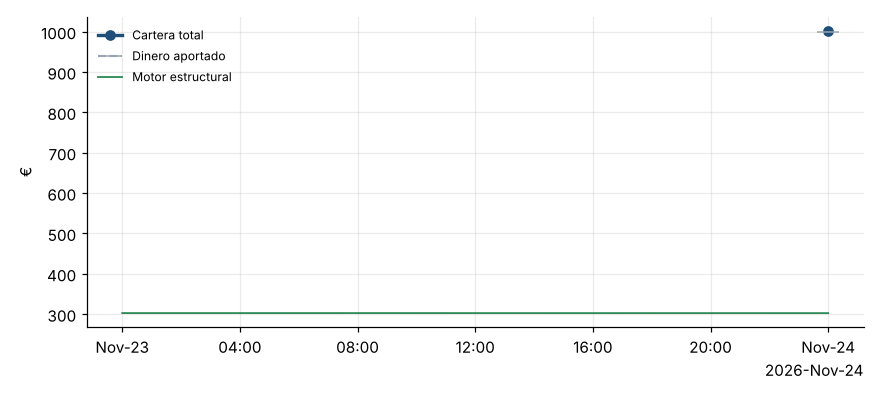

# Panel del sistema · 24/11/2026 15:54 UTC

## Cartera

| Cartera total | Aportado | Resultado | Caída desde máximo | Fase |
|---|---|---|---|---|
| **1.003 €** | 1.000 € | 3 € (+0,3 %) | +0,0 % | agresiva: 70% táctico / 30% estructural |

Próximas aportaciones: 100 € el día 1 de cada mes. Siguiente fase al superar 5.000 € durante 20 días.

## Motores

| Motor | Valor | Kill-switch | Estrategias |
|---|---|---|---|
| ⚡ Táctico (paper) | 700 € | NORMAL | Momentum con tendencia diaria (media sesión) (observacion) |
| 🧱 Estructural | 303 € | NORMAL | Tendencia en cripto + control de volatilidad (aprobada) |

## Posiciones

Sin posiciones abiertas: todo en liquidez a la espera de señales.

## Cuenta paper (Alpaca)

Capital gestionado 1,100 $ · posiciones 457 $ · actualizado 2026-11-24 14:22 UTC

| Activo | Real | Objetivo | Diferencia |
|---|---|---|---|
| DBC | +9,5 % | +0,0 % | +9,5 % ⚠️ |
| EWJ | +8,0 % | +0,0 % | +8,0 % ⚠️ |
| SPY | +9,6 % | +0,0 % | +9,6 % ⚠️ |
| TLT | +5,3 % | +0,0 % | +5,3 % ⚠️ |
| VGK | +9,1 % | +0,0 % | +9,1 % ⚠️ |

## Estrategias en vivo (último auditor)

| Motor | Estrategia | Estado | Días | Resultado en vivo | Caída en vivo | Backtest: CAGR / Sharpe / peor caída | Semáforo |
|---|---|---|---|---|---|---|---|
| estructural | Tendencia en cripto + control de volatilidad | aprobada | 0 | +0,0 % | +0,0 % | +43,6 % / 1,28 / -40 % | ⚪ POCOS DATOS |
| táctico | Momentum con tendencia diaria (media sesión) | observacion | 0 | +0,0 % | +0,0 % | +13,0 % / 0,95 / -20 % | ⚪ POCOS DATOS |

## Últimas órdenes

| Fecha (UTC) | Activo | Acción | Importe | Estado |
|---|---|---|---|---|
| 2026-11-24 10:38 | SPY | cerrar | 106 $ | canceled |
| 2026-11-24 10:38 | TLT | cerrar | 59 $ | canceled |
| 2026-11-24 10:38 | VGK | cerrar | 100 $ | canceled |
| 2026-11-24 10:41 | DBC | cerrar | 104 $ | new |
| 2026-11-24 10:41 | EWJ | cerrar | 88 $ | new |
| 2026-11-24 10:41 | SPY | cerrar | 106 $ | accepted |
| 2026-11-24 10:41 | TLT | cerrar | 59 $ | accepted |
| 2026-11-24 10:41 | VGK | cerrar | 100 $ | new |

## Investigación

- Pruebas acumuladas (listón del Sharpe deflactado): **184**
- Ideas cribadas: 6 · pasaron el cribado: 0
- Informes: [laboratorio](laboratorio/ultimo.md) · [laboratorio táctico](laboratorio/tactico.md) · [auditor](auditor/ultimo.md) · [señales](senales.md)

