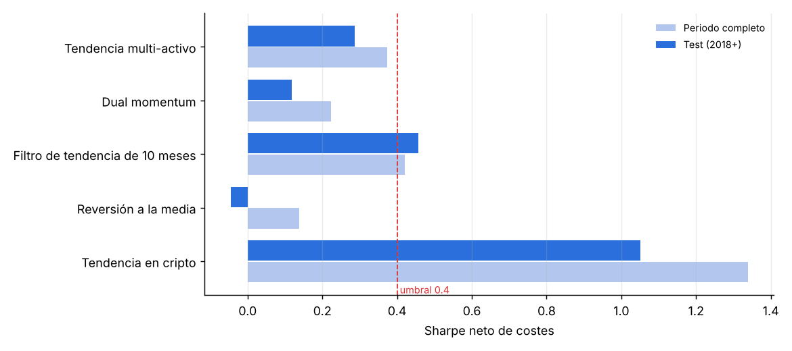
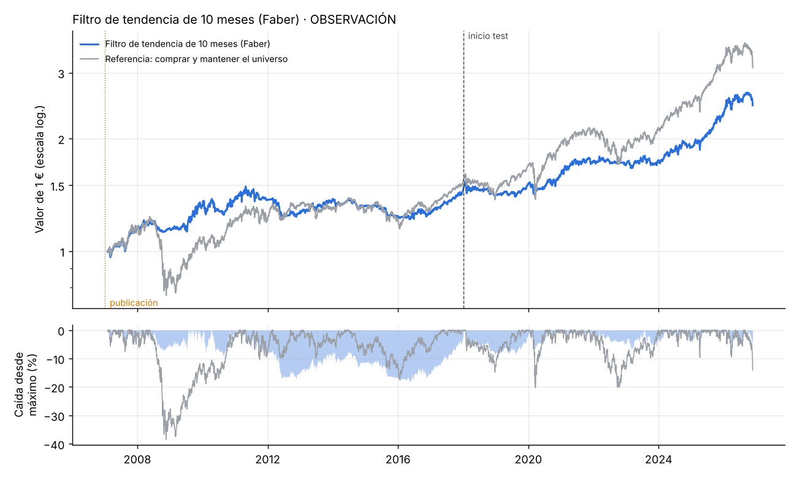
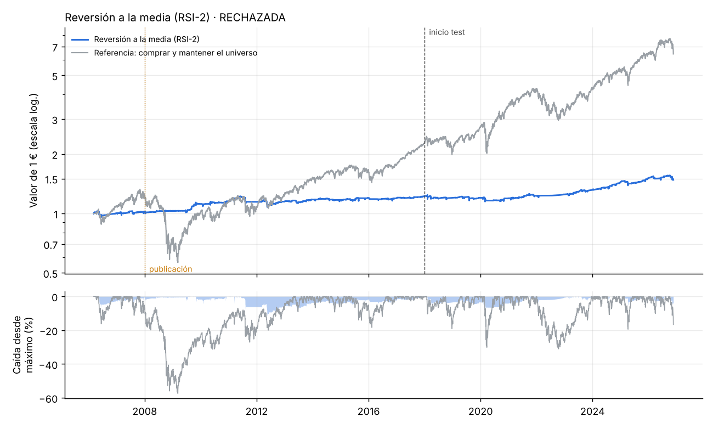
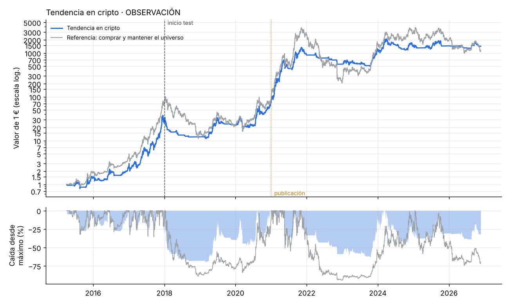

# Validación de estrategias

*Datos hasta 2026-11-22. Costes incluidos. Ejecución al cierre del día siguiente a la señal. 30 variantes probadas en total.*

> Esto es investigación de un sistema, no asesoramiento financiero.

## Resumen

| Estrategia | Papel | Veredicto | Sharpe completo | Sharpe test 2018+ | CAGR | Peor caída | Referencia: peor caída |
|---|---|---|---|---|---|---|---|
| Tendencia multi-activo (TSMOM) | núcleo | ❌ RECHAZADA | 0,37 | 0,29 | 2,9 % | -9 % | -33 % |
| Dual momentum (rotación de bolsas) | núcleo | ❌ RECHAZADA | 0,22 | 0,12 | 3,8 % | -34 % | -45 % |
| Filtro de tendencia de 10 meses (Faber) | control de caídas | 🟡 OBSERVACIÓN | 0,42 | 0,46 | 4,6 % | -18 % | -38 % |
| Reversión a la media (RSI-2) | satélite | ❌ RECHAZADA | 0,14 | -0,05 | 1,9 % | -12 % | -57 % |
| Tendencia en cripto | núcleo cripto | 🟡 OBSERVACIÓN | 1,34 | 1,05 | 86,7 % | -71 % | -95 % |

## Criterios de aprobación

- Sharpe neto en test (2018 en adelante) > 0.4
- Sharpe neto desde la publicación del paper > 0.3 (si hay 3+ años)
- Robustez: al menos 67% de las variantes de parámetros con Sharpe > 0.3
- Walk-forward (elegir cada año el mejor parámetro con datos pasados): Sharpe > 0.3
- Con el doble de costes: Sharpe > 0.3
- Sharpe deflactado (probabilidad de que no sea suerte tras 30 pruebas) > 0.9
- Peor caída dentro del límite de su papel

Sin fallos → APROBADA. Uno o dos fallos no críticos → OBSERVACIÓN. Sharpe de test negativo, o fallo de robustez/test junto con otros → RECHAZADA.

## ❌ Tendencia multi-activo (TSMOM): RECHAZADA

**Referencia:** Moskowitz, Ooi y Pedersen (2012), Time Series Momentum, JFE. **Parámetros:** meses = 12, largo_corto = False. **Universo:** SPY, QQQ, VGK, EWJ, EEM, IEF, TLT, GLD, SLV, USO, DBC, EURUSD=X, GBPUSD=X, JPY=X, AUDUSD=X, CHF=X.

| Periodo | Desde | Años | CAGR | Volatilidad | Sharpe | Peor caída | Operaciones/año | % aciertos | Exposición media |
|---|---|---|---|---|---|---|---|---|---|
| Completo | 2006-03-31 | 20,6 | 2,9 % | 4,4 % | 0,37 | -9 % | 11,2 | 38 % | 59 % |
| Desarrollo (< 2018) | 2006-03-31 | 11,7 | 2,3 % | 4,6 % | 0,43 | -9 % | 11,2 | 36 % | 60 % |
| Test (2018+) | 2018-01-01 | 8,9 | 3,7 % | 4,0 % | 0,29 | -6 % | 11,3 | 40 % | 58 % |
| Desde la publicación | 2012-05-01 | 14,6 | 3,0 % | 3,7 % | 0,39 | -6 % | 12,1 | 38 % | 57 % |
| *Referencia (comprar y mantener)* | | | 5,8 % | 11,7 % | 0,42 | -33 % | | | 100 % |

**Pruebas:**

| Prueba | Resultado | Umbral | |
|---|---|---|---|
| Sharpe en test (2018+) | 0,29 | ≥ 0,40 | ❌ |
| Sharpe post-publicación | 0,39 | ≥ 0,30 | ✅ |
| Robustez de parámetros | 50 % | ≥ 67 % | ❌ |
| Sharpe walk-forward | 0,23 | ≥ 0,30 | ❌ |
| Sharpe con costes x2 | 0,35 | ≥ 0,30 | ✅ |
| Sharpe deflactado (DSR) | 36 % | ≥ 90 % | ❌ |
| Drawdown máximo | -9 % | mejor que -30 % | ✅ |

**Variantes de parámetros (Sharpe completo / test):** meses=3, largo_corto=False: 0,45 / 0,27; meses=3, largo_corto=True: 0,26 / 0,13; meses=6, largo_corto=False: 0,41 / 0,18; meses=6, largo_corto=True: 0,22 / 0,00; meses=9, largo_corto=False: 0,42 / 0,39; meses=9, largo_corto=True: 0,24 / 0,37; meses=12, largo_corto=False: 0,37 / 0,29; meses=12, largo_corto=True: 0,18 / 0,18

## ❌ Dual momentum (rotación de bolsas): RECHAZADA

**Referencia:** Antonacci (2014), Dual Momentum Investing. **Parámetros:** meses = 12. **Universo:** SPY, VGK, EWJ, EEM, IEF.

| Periodo | Desde | Años | CAGR | Volatilidad | Sharpe | Peor caída | Operaciones/año | % aciertos | Exposición media |
|---|---|---|---|---|---|---|---|---|---|
| Completo | 2006-03-31 | 20,6 | 3,8 % | 19,8 % | 0,22 | -34 % | 3,1 | 57 % | 100 % |
| Desarrollo (< 2018) | 2006-03-31 | 11,7 | 4,5 % | 20,1 % | 0,30 | -28 % | 3,3 | 54 % | 100 % |
| Test (2018+) | 2018-01-02 | 8,9 | 3,0 % | 19,4 % | 0,12 | -34 % | 2,7 | 62 % | 100 % |
| Desde la publicación | 2014-11-03 | 12,0 | 2,8 % | 18,3 % | 0,14 | -34 % | 3,1 | 59 % | 100 % |
| *Referencia (comprar y mantener)* | | | 6,1 % | 15,6 % | 0,37 | -45 % | | | 100 % |

**Pruebas:**

| Prueba | Resultado | Umbral | |
|---|---|---|---|
| Sharpe en test (2018+) | 0,12 | ≥ 0,40 | ❌ |
| Sharpe post-publicación | 0,14 | ≥ 0,30 | ❌ |
| Robustez de parámetros | 50 % | ≥ 67 % | ❌ |
| Sharpe walk-forward | 0,10 | ≥ 0,30 | ❌ |
| Sharpe con costes x2 | 0,19 | ≥ 0,30 | ❌ |
| Sharpe deflactado (DSR) | 14 % | ≥ 90 % | ❌ |
| Drawdown máximo | -34 % | mejor que -30 % | ❌ |

**Variantes de parámetros (Sharpe completo / test):** meses=3: 0,30 / 0,12; meses=6: 0,30 / 0,00; meses=9: 0,31 / 0,19; meses=12: 0,22 / 0,12

## 🟡 Filtro de tendencia de 10 meses (Faber): OBSERVACIÓN

**Referencia:** Faber (2007), A Quantitative Approach to Tactical Asset Allocation, JWM. **Parámetros:** meses = 10. **Universo:** SPY, VGK, EWJ, EEM, IEF, GLD, DBC.

| Periodo | Desde | Años | CAGR | Volatilidad | Sharpe | Peor caída | Operaciones/año | % aciertos | Exposición media |
|---|---|---|---|---|---|---|---|---|---|
| Completo | 2007-01-31 | 19,8 | 4,6 % | 8,3 % | 0,42 | -18 % | 6,7 | 43 % | 66 % |
| Desarrollo (< 2018) | 2007-01-31 | 10,9 | 3,5 % | 8,5 % | 0,39 | -18 % | 6,3 | 42 % | 65 % |
| Test (2018+) | 2018-01-02 | 8,9 | 6,1 % | 8,1 % | 0,46 | -9 % | 7,2 | 44 % | 67 % |
| Desde la publicación | 2007-01-31 | 19,8 | 4,6 % | 8,3 % | 0,42 | -18 % | 6,7 | 43 % | 66 % |
| *Referencia (comprar y mantener)* | | | 5,9 % | 12,9 % | 0,40 | -38 % | | | 100 % |

**Pruebas:**

| Prueba | Resultado | Umbral | |
|---|---|---|---|
| Sharpe en test (2018+) | 0,46 | ≥ 0,40 | ✅ |
| Sharpe post-publicación | 0,42 | ≥ 0,30 | ✅ |
| Robustez de parámetros | 100 % | ≥ 67 % | ✅ |
| Sharpe walk-forward | 0,44 | ≥ 0,30 | ✅ |
| Sharpe con costes x2 | 0,40 | ≥ 0,30 | ✅ |
| Sharpe deflactado (DSR) | 42 % | ≥ 90 % | ❌ |
| Drawdown máximo | -18 % | mejor que -25 % | ✅ |

**Variantes de parámetros (Sharpe completo / test):** meses=6: 0,52 / 0,59; meses=8: 0,53 / 0,58; meses=10: 0,42 / 0,46; meses=12: 0,46 / 0,49

## ❌ Reversión a la media (RSI-2): RECHAZADA

**Referencia:** Connors y Alvarez (2008), Short Term Trading Strategies That Work. **Parámetros:** umbral = 10, tendencia = 200. **Universo:** SPY, QQQ, VGK, EWJ, EEM.

| Periodo | Desde | Años | CAGR | Volatilidad | Sharpe | Peor caída | Operaciones/año | % aciertos | Exposición media |
|---|---|---|---|---|---|---|---|---|---|
| Completo | 2006-03-07 | 20,7 | 1,9 % | 5,1 % | 0,14 | -12 % | 36,1 | 67 % | 11 % |
| Desarrollo (< 2018) | 2006-03-07 | 11,8 | 1,7 % | 5,0 % | 0,28 | -12 % | 34,4 | 67 % | 10 % |
| Test (2018+) | 2018-01-02 | 8,9 | 2,2 % | 5,2 % | -0,05 | -8 % | 38,5 | 67 % | 11 % |
| Desde la publicación | 2008-01-02 | 18,9 | 2,0 % | 5,0 % | 0,15 | -12 % | 35,8 | 67 % | 10 % |
| *Referencia (comprar y mantener)* | | | 9,4 % | 21,4 % | 0,46 | -57 % | | | 100 % |

**Pruebas:**

| Prueba | Resultado | Umbral | |
|---|---|---|---|
| Sharpe en test (2018+) | -0,05 | ≥ 0,40 | ❌ |
| Sharpe post-publicación | 0,15 | ≥ 0,30 | ❌ |
| Robustez de parámetros | 0 % | ≥ 67 % | ❌ |
| Sharpe walk-forward | 0,28 | ≥ 0,30 | ❌ |
| Sharpe con costes x2 | -0,15 | ≥ 0,30 | ❌ |
| Sharpe deflactado (DSR) | 7 % | ≥ 90 % | ❌ |
| Drawdown máximo | -12 % | mejor que -25 % | ✅ |

**Variantes de parámetros (Sharpe completo / test):** umbral=5, tendencia=150: 0,22 / -0,09; umbral=5, tendencia=200: 0,14 / -0,11; umbral=5, tendencia=250: 0,16 / -0,07; umbral=10, tendencia=150: 0,12 / -0,04; umbral=10, tendencia=200: 0,14 / -0,05; umbral=10, tendencia=250: 0,13 / -0,05; umbral=15, tendencia=150: 0,16 / 0,04; umbral=15, tendencia=200: 0,14 / -0,03; umbral=15, tendencia=250: 0,12 / -0,07

**Nota:** Su ventaja depende mucho de cuándo se ejecuta. Comprando al cierre del mismo día de la señal (como en el libro) el Sharpe completo sube de 0,14 a 0,33 y el de test, de -0,05 a 0,24: ni así llega al umbral. Se podría replantear calculando la señal minutos antes del cierre y enviando órdenes 'market-on-close' a Alpaca.

## 🟡 Tendencia en cripto: OBSERVACIÓN

**Referencia:** Liu y Tsyvinski (2021), Risks and Returns of Cryptocurrency, RFS. **Parámetros:** dias = 100. **Universo:** BTC-USD, ETH-USD, SOL-USD.

| Periodo | Desde | Años | CAGR | Volatilidad | Sharpe | Peor caída | Operaciones/año | % aciertos | Exposición media |
|---|---|---|---|---|---|---|---|---|---|
| Completo | 2015-04-04 | 11,6 | 86,7 % | 57,5 % | 1,34 | -71 % | 16,6 | 39 % | 57 % |
| Desarrollo (< 2018) | 2015-04-04 | 2,7 | 234,4 % | 68,6 % | 2,10 | -36 % | 5,5 | 53 % | 78 % |
| Test (2018+) | 2018-01-01 | 8,9 | 56,0 % | 53,6 % | 1,05 | -67 % | 20,0 | 38 % | 51 % |
| Desde la publicación | 2021-01-01 | 5,9 | 65,3 % | 52,6 % | 1,16 | -63 % | 24,6 | 39 % | 53 % |
| *Referencia (comprar y mantener)* | | | 82,7 % | 86,6 % | 1,11 | -95 % | | | 100 % |

**Pruebas:**

| Prueba | Resultado | Umbral | |
|---|---|---|---|
| Sharpe en test (2018+) | 1,05 | ≥ 0,40 | ✅ |
| Sharpe post-publicación | 1,16 | ≥ 0,30 | ✅ |
| Robustez de parámetros | 100 % | ≥ 67 % | ✅ |
| Sharpe walk-forward | 1,24 | ≥ 0,30 | ✅ |
| Sharpe con costes x2 | 1,28 | ≥ 0,30 | ✅ |
| Sharpe deflactado (DSR) | 99 % | ≥ 90 % | ✅ |
| Drawdown máximo | -71 % | mejor que -60 % | ❌ |

**Variantes de parámetros (Sharpe completo / test):** dias=20: 1,55 / 1,19; dias=50: 1,65 / 1,41; dias=100: 1,34 / 1,05; dias=150: 1,41 / 1,03; dias=200: 1,36 / 0,98

**Nota:** La peor caída (-71 %) va de diciembre de 2017 a marzo de 2019: el filtro de tendencia sale tarde del desplome de 2018 y recibe varias señales falsas durante el mercado bajista. En la caída de 2021-2022 perdió un 59 %, frente al ~75-80 % de comprar y mantener. Con una volatilidad del 57 % anual, el agente de riesgo deberá limitar mucho su tamaño en cartera.

