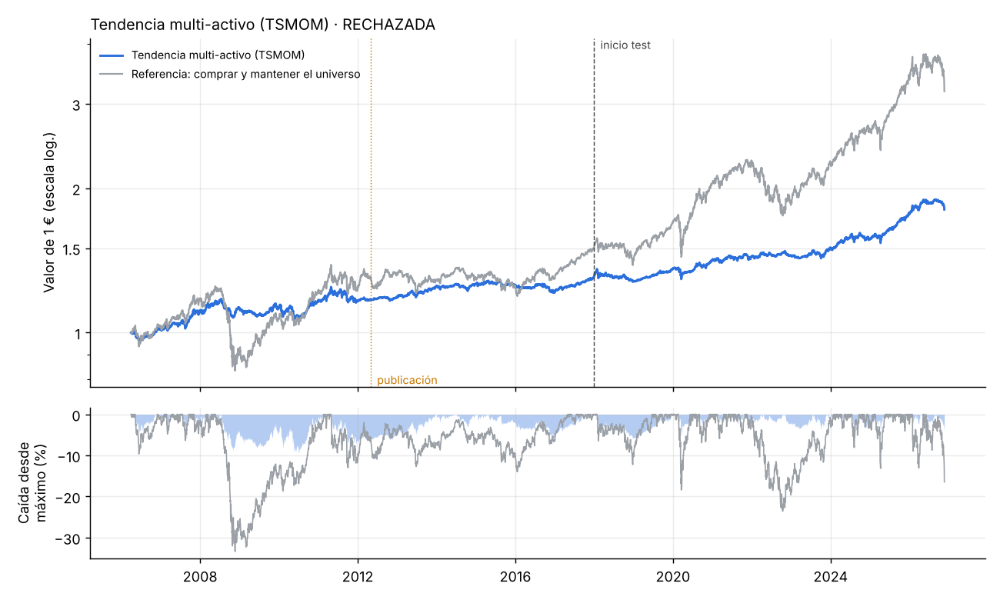
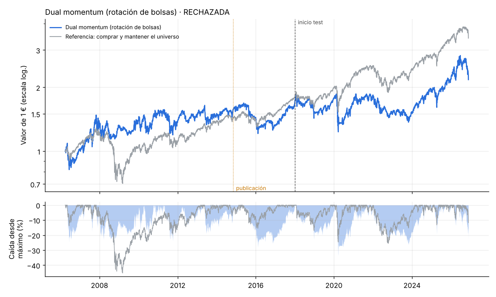
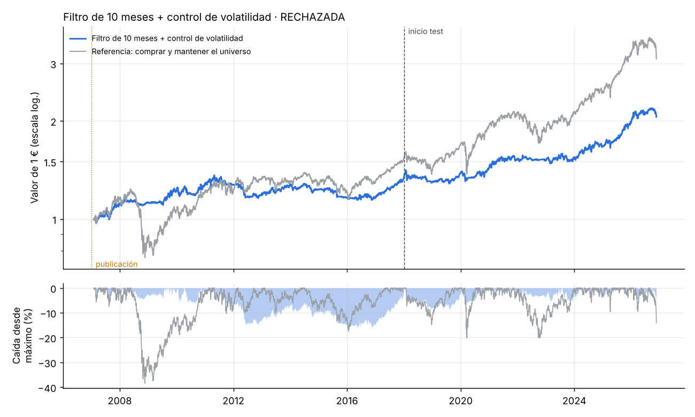
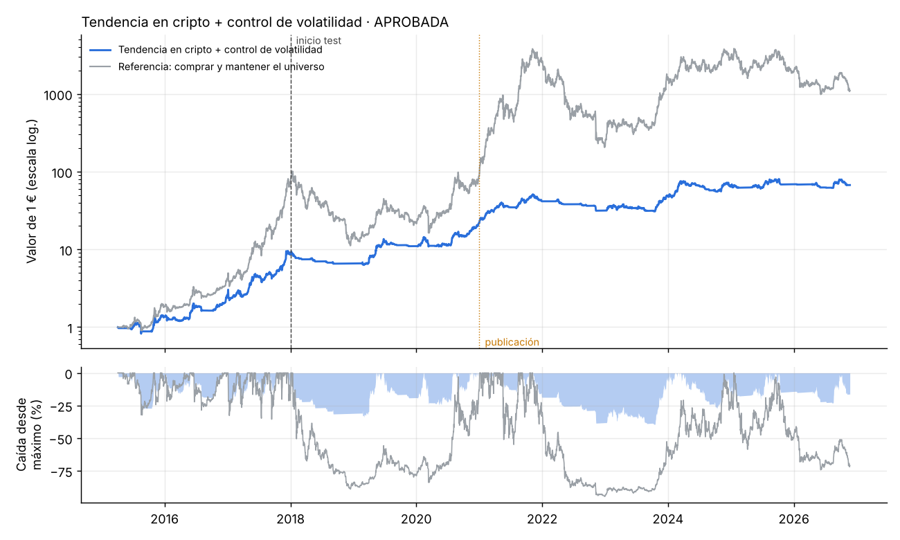
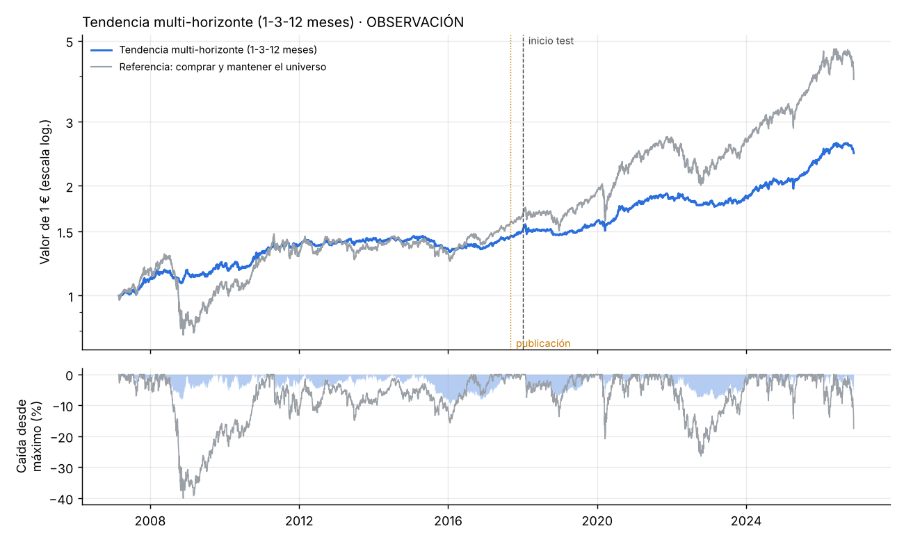
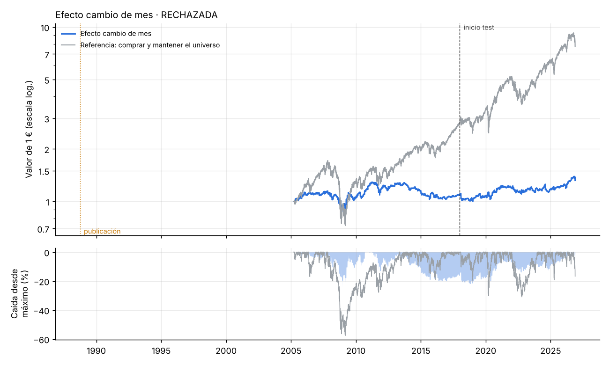
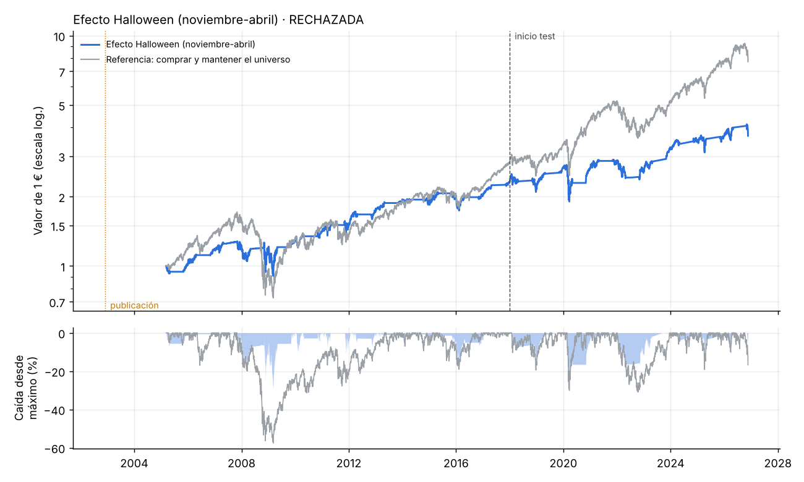
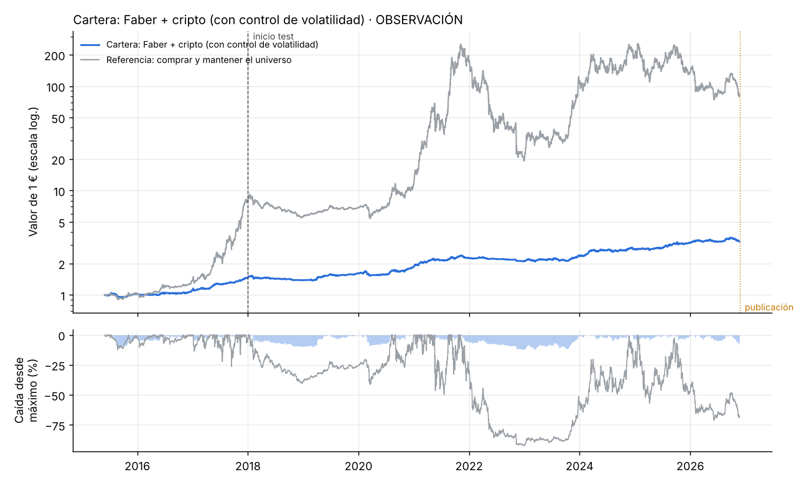

# Validación de estrategias

*Datos hasta 2026-11-22. Costes incluidos. Ejecución al cierre del día siguiente a la señal. 64 variantes probadas en total.*

> Esto es investigación de un sistema, no asesoramiento financiero.

## Resumen

| Estrategia | Papel | Veredicto | Sharpe completo | Sharpe test 2018+ | CAGR | Peor caída | Referencia: peor caída |
|---|---|---|---|---|---|---|---|
| Tendencia multi-activo (TSMOM) | núcleo | ❌ RECHAZADA | 0,37 | 0,29 | 2,9 % | -9 % | -33 % |
| Dual momentum (rotación de bolsas) | núcleo | ❌ RECHAZADA | 0,22 | 0,12 | 3,8 % | -34 % | -45 % |
| Filtro de tendencia de 10 meses (Faber) | control de caídas | 🟡 OBSERVACIÓN | 0,42 | 0,46 | 4,6 % | -18 % | -38 % |
| Reversión a la media (RSI-2) | satélite | ❌ RECHAZADA | 0,14 | -0,05 | 1,9 % | -12 % | -57 % |
| Tendencia en cripto | núcleo cripto | 🟡 OBSERVACIÓN | 1,34 | 1,05 | 86,7 % | -71 % | -95 % |
| Filtro de 10 meses + control de volatilidad | control de caídas | ❌ RECHAZADA | 0,37 | 0,37 | 3,7 % | -16 % | -38 % |
| Tendencia en cripto + control de volatilidad | núcleo cripto | ✅ APROBADA | 1,28 | 0,93 | 43,6 % | -40 % | -95 % |
| Tendencia multi-horizonte (1-3-12 meses) | núcleo | 🟡 OBSERVACIÓN | 0,56 | 0,51 | 4,7 % | -10 % | -40 % |
| Efecto cambio de mes | satélite | ❌ RECHAZADA | 0,04 | -0,00 | 1,3 % | -24 % | -58 % |
| Efecto Halloween (noviembre-abril) | satélite | ❌ RECHAZADA | 0,40 | 0,26 | 6,2 % | -31 % | -58 % |
| Cartera: Faber + cripto (con control de volatilidad) | cartera combinada | 🟡 OBSERVACIÓN | 1,06 | 0,83 | 10,8 % | -13 % | -92 % |

## Criterios de aprobación

- Sharpe neto en test (2018 en adelante) > 0.4
- Sharpe neto desde la publicación del paper > 0.3 (si hay 3+ años)
- Robustez: al menos 67% de las variantes de parámetros con Sharpe > 0.3
- Walk-forward (elegir cada año el mejor parámetro con datos pasados): Sharpe > 0.3
- Con el doble de costes: Sharpe > 0.3
- Sharpe deflactado (probabilidad de que no sea suerte tras 64 pruebas) > 0.9
- Peor caída dentro del límite de su papel

Sin fallos → APROBADA. Uno o dos fallos no críticos → OBSERVACIÓN. Sharpe de test negativo, o fallo de robustez/test junto con otros → RECHAZADA.

## ❌ Tendencia multi-activo (TSMOM): RECHAZADA

**Referencia:** Moskowitz, Ooi y Pedersen (2012), Time Series Momentum, JFE. **Parámetros:** meses = 12, largo_corto = False. **Universo:** SPY, QQQ, VGK, EWJ, EEM, IEF, TLT, GLD, SLV, USO, DBC, EURUSD=X, GBPUSD=X, JPY=X, AUDUSD=X, CHF=X.

| Periodo | Desde | Años | CAGR | Volatilidad | Sharpe | Peor caída | Operaciones/año | % aciertos | Exposición media |
|---|---|---|---|---|---|---|---|---|---|
| Completo | 2006-03-31 | 20,6 | 2,9 % | 4,4 % | 0,37 | -9 % | 11,2 | 38 % | 59 % |
| Desarrollo (< 2018) | 2006-03-31 | 11,7 | 2,3 % | 4,6 % | 0,43 | -9 % | 11,2 | 36 % | 60 % |
| Test (2018+) | 2018-01-01 | 8,9 | 3,7 % | 4,0 % | 0,29 | -6 % | 11,3 | 40 % | 58 % |
| Desde la publicación | 2012-05-01 | 14,6 | 3,0 % | 3,7 % | 0,39 | -6 % | 12,1 | 38 % | 57 % |
| *Referencia (comprar y mantener)* | | | 5,8 % | 11,7 % | 0,42 | -33 % | | | 100 % |

**Pruebas:**

| Prueba | Resultado | Umbral | |
|---|---|---|---|
| Sharpe en test (2018+) | 0,29 | ≥ 0,40 | ❌ |
| Sharpe post-publicación | 0,39 | ≥ 0,30 | ✅ |
| Robustez de parámetros | 50 % | ≥ 67 % | ❌ |
| Sharpe walk-forward | 0,23 | ≥ 0,30 | ❌ |
| Sharpe con costes x2 | 0,35 | ≥ 0,30 | ✅ |
| Sharpe deflactado (DSR) | 25 % | ≥ 90 % | ❌ |
| Drawdown máximo | -9 % | mejor que -30 % | ✅ |

**Variantes de parámetros (Sharpe completo / test):** meses=3, largo_corto=False: 0,45 / 0,27; meses=3, largo_corto=True: 0,26 / 0,13; meses=6, largo_corto=False: 0,41 / 0,18; meses=6, largo_corto=True: 0,22 / 0,00; meses=9, largo_corto=False: 0,42 / 0,39; meses=9, largo_corto=True: 0,24 / 0,37; meses=12, largo_corto=False: 0,37 / 0,29; meses=12, largo_corto=True: 0,18 / 0,18

## ❌ Dual momentum (rotación de bolsas): RECHAZADA

**Referencia:** Antonacci (2014), Dual Momentum Investing. **Parámetros:** meses = 12. **Universo:** SPY, VGK, EWJ, EEM, IEF.

| Periodo | Desde | Años | CAGR | Volatilidad | Sharpe | Peor caída | Operaciones/año | % aciertos | Exposición media |
|---|---|---|---|---|---|---|---|---|---|
| Completo | 2006-03-31 | 20,6 | 3,8 % | 19,8 % | 0,22 | -34 % | 3,1 | 57 % | 100 % |
| Desarrollo (< 2018) | 2006-03-31 | 11,7 | 4,5 % | 20,1 % | 0,30 | -28 % | 3,3 | 54 % | 100 % |
| Test (2018+) | 2018-01-02 | 8,9 | 3,0 % | 19,4 % | 0,12 | -34 % | 2,7 | 62 % | 100 % |
| Desde la publicación | 2014-11-03 | 12,0 | 2,8 % | 18,3 % | 0,14 | -34 % | 3,1 | 59 % | 100 % |
| *Referencia (comprar y mantener)* | | | 6,1 % | 15,6 % | 0,37 | -45 % | | | 100 % |

**Pruebas:**

| Prueba | Resultado | Umbral | |
|---|---|---|---|
| Sharpe en test (2018+) | 0,12 | ≥ 0,40 | ❌ |
| Sharpe post-publicación | 0,14 | ≥ 0,30 | ❌ |
| Robustez de parámetros | 50 % | ≥ 67 % | ❌ |
| Sharpe walk-forward | 0,10 | ≥ 0,30 | ❌ |
| Sharpe con costes x2 | 0,19 | ≥ 0,30 | ❌ |
| Sharpe deflactado (DSR) | 9 % | ≥ 90 % | ❌ |
| Drawdown máximo | -34 % | mejor que -30 % | ❌ |

**Variantes de parámetros (Sharpe completo / test):** meses=3: 0,30 / 0,12; meses=6: 0,30 / 0,00; meses=9: 0,31 / 0,19; meses=12: 0,22 / 0,12

## 🟡 Filtro de tendencia de 10 meses (Faber): OBSERVACIÓN

**Referencia:** Faber (2007), A Quantitative Approach to Tactical Asset Allocation, JWM. **Parámetros:** meses = 10. **Universo:** SPY, VGK, EWJ, EEM, IEF, GLD, DBC.

| Periodo | Desde | Años | CAGR | Volatilidad | Sharpe | Peor caída | Operaciones/año | % aciertos | Exposición media |
|---|---|---|---|---|---|---|---|---|---|
| Completo | 2007-01-31 | 19,8 | 4,6 % | 8,3 % | 0,42 | -18 % | 6,7 | 43 % | 66 % |
| Desarrollo (< 2018) | 2007-01-31 | 10,9 | 3,5 % | 8,5 % | 0,39 | -18 % | 6,3 | 42 % | 65 % |
| Test (2018+) | 2018-01-02 | 8,9 | 6,1 % | 8,1 % | 0,46 | -9 % | 7,2 | 44 % | 67 % |
| Desde la publicación | 2007-01-31 | 19,8 | 4,6 % | 8,3 % | 0,42 | -18 % | 6,7 | 43 % | 66 % |
| *Referencia (comprar y mantener)* | | | 5,9 % | 12,9 % | 0,40 | -38 % | | | 100 % |

**Pruebas:**

| Prueba | Resultado | Umbral | |
|---|---|---|---|
| Sharpe en test (2018+) | 0,46 | ≥ 0,40 | ✅ |
| Sharpe post-publicación | 0,42 | ≥ 0,30 | ✅ |
| Robustez de parámetros | 100 % | ≥ 67 % | ✅ |
| Sharpe walk-forward | 0,44 | ≥ 0,30 | ✅ |
| Sharpe con costes x2 | 0,40 | ≥ 0,30 | ✅ |
| Sharpe deflactado (DSR) | 31 % | ≥ 90 % | ❌ |
| Drawdown máximo | -18 % | mejor que -25 % | ✅ |

**Variantes de parámetros (Sharpe completo / test):** meses=6: 0,52 / 0,59; meses=8: 0,53 / 0,58; meses=10: 0,42 / 0,46; meses=12: 0,46 / 0,49

## ❌ Reversión a la media (RSI-2): RECHAZADA

**Referencia:** Connors y Alvarez (2008), Short Term Trading Strategies That Work. **Parámetros:** umbral = 10, tendencia = 200. **Universo:** SPY, QQQ, VGK, EWJ, EEM.

| Periodo | Desde | Años | CAGR | Volatilidad | Sharpe | Peor caída | Operaciones/año | % aciertos | Exposición media |
|---|---|---|---|---|---|---|---|---|---|
| Completo | 2006-03-07 | 20,7 | 1,9 % | 5,1 % | 0,14 | -12 % | 36,1 | 66 % | 11 % |
| Desarrollo (< 2018) | 2006-03-07 | 11,8 | 1,7 % | 5,0 % | 0,28 | -12 % | 34,4 | 66 % | 10 % |
| Test (2018+) | 2018-01-02 | 8,9 | 2,2 % | 5,2 % | -0,05 | -8 % | 38,5 | 66 % | 11 % |
| Desde la publicación | 2008-01-02 | 18,9 | 2,0 % | 5,0 % | 0,15 | -12 % | 35,8 | 67 % | 10 % |
| *Referencia (comprar y mantener)* | | | 9,4 % | 21,4 % | 0,46 | -57 % | | | 100 % |

**Pruebas:**

| Prueba | Resultado | Umbral | |
|---|---|---|---|
| Sharpe en test (2018+) | -0,05 | ≥ 0,40 | ❌ |
| Sharpe post-publicación | 0,15 | ≥ 0,30 | ❌ |
| Robustez de parámetros | 0 % | ≥ 67 % | ❌ |
| Sharpe walk-forward | 0,28 | ≥ 0,30 | ❌ |
| Sharpe con costes x2 | -0,15 | ≥ 0,30 | ❌ |
| Sharpe deflactado (DSR) | 4 % | ≥ 90 % | ❌ |
| Drawdown máximo | -12 % | mejor que -25 % | ✅ |

**Variantes de parámetros (Sharpe completo / test):** umbral=5, tendencia=150: 0,22 / -0,09; umbral=5, tendencia=200: 0,14 / -0,12; umbral=5, tendencia=250: 0,16 / -0,08; umbral=10, tendencia=150: 0,11 / -0,04; umbral=10, tendencia=200: 0,14 / -0,05; umbral=10, tendencia=250: 0,13 / -0,05; umbral=15, tendencia=150: 0,15 / 0,04; umbral=15, tendencia=200: 0,13 / -0,03; umbral=15, tendencia=250: 0,11 / -0,08

**Nota:** Su ventaja depende mucho de cuándo se ejecuta. Comprando al cierre del mismo día de la señal (como en el libro) el Sharpe completo sube de 0,14 a 0,33 y el de test, de -0,05 a 0,24: ni así llega al umbral. Se podría replantear calculando la señal minutos antes del cierre y enviando órdenes 'market-on-close' a Alpaca.

## 🟡 Tendencia en cripto: OBSERVACIÓN

**Referencia:** Liu y Tsyvinski (2021), Risks and Returns of Cryptocurrency, RFS. **Parámetros:** dias = 100. **Universo:** BTC-USD, ETH-USD, SOL-USD.

| Periodo | Desde | Años | CAGR | Volatilidad | Sharpe | Peor caída | Operaciones/año | % aciertos | Exposición media |
|---|---|---|---|---|---|---|---|---|---|
| Completo | 2015-04-04 | 11,6 | 86,7 % | 57,5 % | 1,34 | -71 % | 16,6 | 39 % | 57 % |
| Desarrollo (< 2018) | 2015-04-04 | 2,7 | 234,4 % | 68,6 % | 2,10 | -36 % | 5,5 | 53 % | 78 % |
| Test (2018+) | 2018-01-01 | 8,9 | 56,0 % | 53,6 % | 1,05 | -67 % | 20,0 | 38 % | 51 % |
| Desde la publicación | 2021-01-01 | 5,9 | 65,3 % | 52,6 % | 1,16 | -63 % | 24,6 | 39 % | 53 % |
| *Referencia (comprar y mantener)* | | | 82,7 % | 86,6 % | 1,11 | -95 % | | | 100 % |

**Pruebas:**

| Prueba | Resultado | Umbral | |
|---|---|---|---|
| Sharpe en test (2018+) | 1,05 | ≥ 0,40 | ✅ |
| Sharpe post-publicación | 1,16 | ≥ 0,30 | ✅ |
| Robustez de parámetros | 100 % | ≥ 67 % | ✅ |
| Sharpe walk-forward | 1,24 | ≥ 0,30 | ✅ |
| Sharpe con costes x2 | 1,28 | ≥ 0,30 | ✅ |
| Sharpe deflactado (DSR) | 99 % | ≥ 90 % | ✅ |
| Drawdown máximo | -71 % | mejor que -60 % | ❌ |

**Variantes de parámetros (Sharpe completo / test):** dias=20: 1,55 / 1,19; dias=50: 1,65 / 1,41; dias=100: 1,34 / 1,05; dias=150: 1,41 / 1,03; dias=200: 1,36 / 0,98

**Nota:** La peor caída (-71 %) va de diciembre de 2017 a marzo de 2019: el filtro de tendencia sale tarde del desplome de 2018 y recibe varias señales falsas durante el mercado bajista. En la caída de 2021-2022 perdió un 59 %, frente al ~75-80 % de comprar y mantener. Con una volatilidad del 57 % anual, el agente de riesgo deberá limitar mucho su tamaño en cartera.

## ❌ Filtro de 10 meses + control de volatilidad: RECHAZADA

**Referencia:** Faber (2007), A Quantitative Approach to Tactical Asset Allocation, JWM + Moreira y Muir (2017), Volatility-Managed Portfolios, JF. **Parámetros:** meses = 10, vol_objetivo = 0.15. **Universo:** SPY, VGK, EWJ, EEM, IEF, GLD, DBC.

| Periodo | Desde | Años | CAGR | Volatilidad | Sharpe | Peor caída | Operaciones/año | % aciertos | Exposición media |
|---|---|---|---|---|---|---|---|---|---|
| Completo | 2007-01-31 | 19,8 | 3,7 % | 6,8 % | 0,37 | -16 % | 6,7 | 43 % | 59 % |
| Desarrollo (< 2018) | 2007-01-31 | 10,9 | 2,7 % | 6,7 % | 0,37 | -16 % | 6,3 | 42 % | 57 % |
| Test (2018+) | 2018-01-02 | 8,9 | 5,0 % | 6,9 % | 0,37 | -9 % | 7,2 | 44 % | 61 % |
| Desde la publicación | 2007-01-31 | 19,8 | 3,7 % | 6,8 % | 0,37 | -16 % | 6,7 | 43 % | 59 % |
| *Referencia (comprar y mantener)* | | | 5,9 % | 12,9 % | 0,40 | -38 % | | | 100 % |

**Pruebas:**

| Prueba | Resultado | Umbral | |
|---|---|---|---|
| Sharpe en test (2018+) | 0,37 | ≥ 0,40 | ❌ |
| Sharpe post-publicación | 0,37 | ≥ 0,30 | ✅ |
| Robustez de parámetros | 100 % | ≥ 67 % | ✅ |
| Sharpe walk-forward | 0,42 | ≥ 0,30 | ✅ |
| Sharpe con costes x2 | 0,33 | ≥ 0,30 | ✅ |
| Sharpe deflactado (DSR) | 23 % | ≥ 90 % | ❌ |
| Drawdown máximo | -16 % | mejor que -25 % | ✅ |

**Variantes de parámetros (Sharpe completo / test):** meses=8, vol_objetivo=0.1: 0,44 / 0,39; meses=8, vol_objetivo=0.15: 0,48 / 0,48; meses=8, vol_objetivo=0.2: 0,49 / 0,53; meses=10, vol_objetivo=0.1: 0,33 / 0,28; meses=10, vol_objetivo=0.15: 0,37 / 0,37; meses=10, vol_objetivo=0.2: 0,38 / 0,41; meses=12, vol_objetivo=0.1: 0,42 / 0,34; meses=12, vol_objetivo=0.15: 0,44 / 0,41; meses=12, vol_objetivo=0.2: 0,45 / 0,45

**Nota:** Aquí el control de volatilidad resta en vez de sumar: Faber ya sale de los activos en caída, y recortar además por volatilidad deja la cartera demasiado infrainvertida en las recuperaciones.

## ✅ Tendencia en cripto + control de volatilidad: APROBADA

**Referencia:** Liu y Tsyvinski (2021), Risks and Returns of Cryptocurrency, RFS + Moreira y Muir (2017), Volatility-Managed Portfolios, JF. **Parámetros:** dias = 100, vol_objetivo = 0.4. **Universo:** BTC-USD, ETH-USD, SOL-USD.

| Periodo | Desde | Años | CAGR | Volatilidad | Sharpe | Peor caída | Operaciones/año | % aciertos | Exposición media |
|---|---|---|---|---|---|---|---|---|---|
| Completo | 2015-04-05 | 11,6 | 43,6 % | 30,3 % | 1,28 | -40 % | 16,6 | 39 % | 36 % |
| Desarrollo (< 2018) | 2015-04-05 | 2,7 | 120,8 % | 42,4 % | 2,08 | -32 % | 5,5 | 53 % | 53 % |
| Test (2018+) | 2018-01-01 | 8,9 | 25,8 % | 25,3 % | 0,93 | -40 % | 20,0 | 38 % | 30 % |
| Desde la publicación | 2021-01-01 | 5,9 | 21,0 % | 24,8 % | 0,77 | -40 % | 24,6 | 39 % | 33 % |
| *Referencia (comprar y mantener)* | | | 82,7 % | 86,7 % | 1,11 | -95 % | | | 100 % |

**Pruebas:**

| Prueba | Resultado | Umbral | |
|---|---|---|---|
| Sharpe en test (2018+) | 0,93 | ≥ 0,40 | ✅ |
| Sharpe post-publicación | 0,77 | ≥ 0,30 | ✅ |
| Robustez de parámetros | 100 % | ≥ 67 % | ✅ |
| Sharpe walk-forward | 1,26 | ≥ 0,30 | ✅ |
| Sharpe con costes x2 | 1,20 | ≥ 0,30 | ✅ |
| Sharpe deflactado (DSR) | 98 % | ≥ 90 % | ✅ |
| Drawdown máximo | -40 % | mejor que -60 % | ✅ |

**Variantes de parámetros (Sharpe completo / test):** dias=50, vol_objetivo=0.3: 1,65 / 1,26; dias=50, vol_objetivo=0.4: 1,61 / 1,24; dias=50, vol_objetivo=0.6: 1,55 / 1,21; dias=100, vol_objetivo=0.3: 1,32 / 0,94; dias=100, vol_objetivo=0.4: 1,28 / 0,93; dias=100, vol_objetivo=0.6: 1,24 / 0,90; dias=200, vol_objetivo=0.3: 1,37 / 0,87; dias=200, vol_objetivo=0.4: 1,34 / 0,87; dias=200, vol_objetivo=0.6: 1,33 / 0,87

**Nota:** El control de volatilidad reduce la exposición media del 57 % al 36 % y la peor caída de -71 % a -40 %, con un Sharpe casi igual (1,28 frente a 1,34). Es la primera estrategia aprobada del sistema.

## 🟡 Tendencia multi-horizonte (1-3-12 meses): OBSERVACIÓN

**Referencia:** Hurst, Ooi y Pedersen (2017), A Century of Evidence on Trend-Following Investing, JPM. **Parámetros:** horizontes = (1, 3, 12). **Universo:** SPY, QQQ, VGK, EWJ, EEM, IEF, TLT, GLD, SLV, USO, DBC.

| Periodo | Desde | Años | CAGR | Volatilidad | Sharpe | Peor caída | Operaciones/año | % aciertos | Exposición media |
|---|---|---|---|---|---|---|---|---|---|
| Completo | 2007-02-28 | 19,7 | 4,7 % | 6,0 % | 0,56 | -10 % | 11,2 | 39 % | 62 % |
| Desarrollo (< 2018) | 2007-02-28 | 10,8 | 3,8 % | 5,8 % | 0,60 | -10 % | 11,1 | 37 % | 63 % |
| Test (2018+) | 2018-01-02 | 8,9 | 5,7 % | 6,3 % | 0,51 | -8 % | 11,4 | 42 % | 60 % |
| Desde la publicación | 2017-09-01 | 9,2 | 5,9 % | 6,2 % | 0,55 | -8 % | 11,4 | 42 % | 61 % |
| *Referencia (comprar y mantener)* | | | 7,2 % | 14,0 % | 0,46 | -40 % | | | 100 % |

**Pruebas:**

| Prueba | Resultado | Umbral | |
|---|---|---|---|
| Sharpe en test (2018+) | 0,51 | ≥ 0,40 | ✅ |
| Sharpe post-publicación | 0,55 | ≥ 0,30 | ✅ |
| Robustez de parámetros | 100 % | ≥ 67 % | ✅ |
| Sharpe walk-forward | 0,51 | ≥ 0,30 | ✅ |
| Sharpe con costes x2 | 0,50 | ≥ 0,30 | ✅ |
| Sharpe deflactado (DSR) | 54 % | ≥ 90 % | ❌ |
| Drawdown máximo | -10 % | mejor que -30 % | ✅ |

**Variantes de parámetros (Sharpe completo / test):** horizontes=(1, 3, 12): 0,56 / 0,51; horizontes=(3, 6, 12): 0,60 / 0,53; horizontes=(1, 3, 6, 12): 0,57 / 0,51

**Nota:** Pasa todas las pruebas menos el Sharpe deflactado: con 20 años de datos, un Sharpe de 0,56 no basta para descartar la suerte tras 64 pruebas. Mejora claramente a la TSMOM de un solo horizonte (0,37).

## ❌ Efecto cambio de mes: RECHAZADA

**Referencia:** Lakonishok y Smidt (1988), RFS; Xu y McConnell (2008), The Turn-of-the-Month Effect, JFE. **Parámetros:** antes = 1, despues = 3. **Universo:** SPY, QQQ, VGK, EWJ, EEM.

| Periodo | Desde | Años | CAGR | Volatilidad | Sharpe | Peor caída | Operaciones/año | % aciertos | Exposición media |
|---|---|---|---|---|---|---|---|---|---|
| Completo | 2005-03-10 | 21,7 | 1,3 % | 8,5 % | 0,04 | -24 % | 60,2 | 57 % | 19 % |
| Desarrollo (< 2018) | 2005-03-10 | 12,8 | 0,6 % | 8,9 % | 0,07 | -24 % | 59,8 | 55 % | 19 % |
| Test (2018+) | 2018-01-02 | 8,9 | 2,3 % | 7,8 % | -0,00 | -11 % | 60,8 | 59 % | 19 % |
| Desde la publicación | 2005-03-10 | 21,7 | 1,3 % | 8,5 % | 0,04 | -24 % | 60,2 | 57 % | 19 % |
| *Referencia (comprar y mantener)* | | | 9,9 % | 21,2 % | 0,49 | -58 % | | | 100 % |

**Pruebas:**

| Prueba | Resultado | Umbral | |
|---|---|---|---|
| Sharpe en test (2018+) | -0,00 | ≥ 0,40 | ❌ |
| Sharpe post-publicación | 0,04 | ≥ 0,30 | ❌ |
| Robustez de parámetros | 0 % | ≥ 67 % | ❌ |
| Sharpe walk-forward | -0,04 | ≥ 0,30 | ❌ |
| Sharpe con costes x2 | -0,24 | ≥ 0,30 | ❌ |
| Sharpe deflactado (DSR) | 2 % | ≥ 90 % | ❌ |
| Drawdown máximo | -24 % | mejor que -25 % | ✅ |

**Variantes de parámetros (Sharpe completo / test):** antes=1, despues=2: 0,04 / -0,20; antes=1, despues=3: 0,04 / -0,00; antes=1, despues=4: -0,05 / -0,02; antes=2, despues=2: 0,16 / 0,06; antes=2, despues=3: 0,16 / 0,20; antes=2, despues=4: 0,06 / 0,15

## ❌ Efecto Halloween (noviembre-abril): RECHAZADA

**Referencia:** Bouman y Jacobsen (2002), The Halloween Indicator, AER. **Parámetros:** entrada = 11, salida = 4. **Universo:** SPY, QQQ, VGK, EWJ, EEM.

| Periodo | Desde | Años | CAGR | Volatilidad | Sharpe | Peor caída | Operaciones/año | % aciertos | Exposición media |
|---|---|---|---|---|---|---|---|---|---|
| Completo | 2005-03-10 | 21,7 | 6,2 % | 14,5 % | 0,40 | -31 % | 5,1 | 70 % | 48 % |
| Desarrollo (< 2018) | 2005-03-10 | 12,8 | 6,8 % | 14,2 % | 0,50 | -29 % | 5,1 | 68 % | 48 % |
| Test (2018+) | 2018-01-02 | 8,9 | 5,4 % | 14,8 % | 0,26 | -31 % | 5,1 | 73 % | 49 % |
| Desde la publicación | 2005-03-10 | 21,7 | 6,2 % | 14,5 % | 0,40 | -31 % | 5,1 | 70 % | 48 % |
| *Referencia (comprar y mantener)* | | | 9,9 % | 21,2 % | 0,49 | -58 % | | | 100 % |

**Pruebas:**

| Prueba | Resultado | Umbral | |
|---|---|---|---|
| Sharpe en test (2018+) | 0,26 | ≥ 0,40 | ❌ |
| Sharpe post-publicación | 0,40 | ≥ 0,30 | ✅ |
| Robustez de parámetros | 100 % | ≥ 67 % | ✅ |
| Sharpe walk-forward | 0,29 | ≥ 0,30 | ❌ |
| Sharpe con costes x2 | 0,39 | ≥ 0,30 | ✅ |
| Sharpe deflactado (DSR) | 31 % | ≥ 90 % | ❌ |
| Drawdown máximo | -31 % | mejor que -30 % | ❌ |

**Variantes de parámetros (Sharpe completo / test):** entrada=10, salida=4: 0,38 / 0,22; entrada=10, salida=5: 0,41 / 0,37; entrada=11, salida=4: 0,40 / 0,26; entrada=11, salida=5: 0,43 / 0,42

## 🟡 Cartera: Faber + cripto (con control de volatilidad): OBSERVACIÓN

**Referencia:** Combinación por paridad de riesgo de las estrategias en observación. **Parámetros:** tope_cripto = 0.25. **Universo:** BTC-USD, DBC, EEM, ETH-USD, EWJ, GLD, IEF, SOL-USD, SPY, VGK.

| Periodo | Desde | Años | CAGR | Volatilidad | Sharpe | Peor caída | Operaciones/año | % aciertos | Exposición media |
|---|---|---|---|---|---|---|---|---|---|
| Completo | 2015-05-31 | 11,5 | 10,8 % | 8,1 % | 1,06 | -13 % | 23,7 | 40 % | 57 % |
| Desarrollo (< 2018) | 2015-05-31 | 2,6 | 15,9 % | 7,8 % | 1,89 | -9 % | 11,6 | 37 % | 61 % |
| Test (2018+) | 2018-01-01 | 8,9 | 9,4 % | 8,2 % | 0,83 | -13 % | 27,2 | 40 % | 55 % |
| *Referencia (comprar y mantener)* | | | 46,7 % | 63,7 % | 0,89 | -92 % | | | 100 % |

**Pruebas:**

| Prueba | Resultado | Umbral | |
|---|---|---|---|
| Sharpe en test (2018+) | 0,83 | ≥ 0,40 | ✅ |
| Robustez de parámetros | 100 % | ≥ 67 % | ✅ |
| Sharpe walk-forward | 0,82 | ≥ 0,30 | ✅ |
| Sharpe con costes x2 | 0,97 | ≥ 0,30 | ✅ |
| Sharpe deflactado (DSR) | 88 % | ≥ 90 % | ❌ |
| Drawdown máximo | -13 % | mejor que -25 % | ✅ |

**Variantes de parámetros (Sharpe completo / test):** tope_cripto=0.15: 1,02 / 0,77; tope_cripto=0.25: 1,06 / 0,83; tope_cripto=0.35: 1,05 / 0,82

**Nota:** Composición fijada antes de ver resultados (incluye Faber con control de volatilidad, que luego salió rechazada). La referencia 'comprar y mantener' pesa cripto con 3 de 10 activos, por eso su CAGR es tan alto y su caída tan grande; no es una comparación justa de riesgo. Sin fecha de publicación: no hay periodo posterior a la publicación que evaluar.

